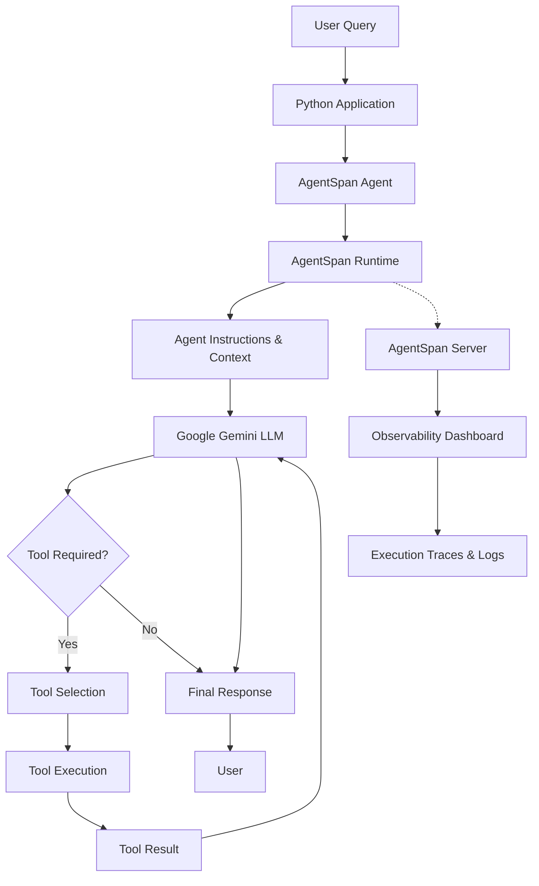

# Agentic AI Projects with Python & AgentSpan

A hands-on **Agentic AI development project** built with Python, AgentSpan, and Google Gemini. This project explores how to build, execute, monitor, and debug intelligent AI agents capable of using external tools, maintaining conversation memory, searching the internet, handling structured outputs, and performing human-approved actions.

The project focuses on understanding the complete agent execution lifecycle — from receiving a user query to reasoning through an LLM, selecting tools, processing tool results, and generating the final response.

## Tech Stack

- **Python** – Core programming language
- **uv** – Python package and dependency management
- **AgentSpan** – AI agent development, runtime execution, and observability
- **Google Gemini** – Large Language Model (LLM)
- **Tavily** – Real-time internet search
- **Pydantic** – Structured output validation
- **python-dotenv** – Environment variable management

## Project Features

### 1. AI Chatbot Agent (`chatbot_agent.py`)

An interactive AI chatbot named Alex, powered by Google Gemini and AgentSpan.

**Features:**
- Gemini LLM integration.
- Conversation memory using `ConversationMemory`.
- Custom tools using AgentSpan's `@tool` decorator.
- Internet search using Tavily.
- Automatic tool selection based on user queries.
- Interactive terminal-based conversation.
- Session-based conversation management.

**How it works:**

1. The user submits a query through the terminal.
2. The AgentSpan agent receives the query.
3. The agent uses its instructions and available tools to determine how to handle the request.
4. When necessary, it calls the greeting or internet search tool.
5. Tool results are returned to the agent.
6. Google Gemini generates the final response.
7. Conversation memory maintains context across messages in the same session.

### 2. Customer Support Agent (`customer_support.py`)

An AI-powered customer support agent designed to handle customer queries, retrieve order information, and manage refund requests with human approval.

**Features:**
- Order lookup using a database tool.
- Refund processing with human-in-the-loop approval.
- Prompt injection protection using input guardrails.
- Structured AI responses using Pydantic.
- Conversation memory.
- Streaming agent execution.
- Human approval and rejection workflows.

**How it works:**

1. A customer submits a query.
2. Input guardrails inspect the prompt for potentially malicious instructions.
3. The agent understands the customer's request.
4. For order-related queries, it calls the database tool.
5. For refund requests, it retrieves order information and prepares a refund request.
6. AgentSpan pauses execution when human approval is required.
7. The human reviews and approves or rejects the operation.
8. The agent continues execution and generates a structured response.

### 3. AgentSpan Runtime & Observability

AgentSpan is an important part of this project, not just a framework used to create agents. It provides the execution infrastructure and observability capabilities needed to understand how agents work internally.

The AgentSpan runtime executes agent workflows, while its separate server and dashboard help developers monitor and debug those executions.

**Key capabilities:**

- **Agent Runtime:** Execute AI agents and manage their execution lifecycle.
- **Execution Tracing:** Inspect how a user query moves through the agent workflow.
- **LLM Interaction Monitoring:** Understand when the agent communicates with the LLM and how responses are generated.
- **Tool Execution Tracking:** Observe which tools are selected, invoked, and completed.
- **Execution Events:** Monitor events such as tool calls, tool results, and waiting states.
- **Logs & Debugging:** Investigate execution failures and identify bottlenecks.
- **Human-in-the-Loop:** Pause agent execution for approval before performing sensitive operations.

#### Agent Execution Workflow

The following diagram illustrates the overall workflow of an agent in this project:



#### Starting the AgentSpan Server

Start the AgentSpan server in a separate terminal:

```bash
uv run agentspan server start
```

View live server logs:

```bash
uv run agentspan server logs -f
```

Stop the server:

```bash
uv run agentspan server stop
```

Run your Python agent in another terminal:

```bash
uv run python chatbot_agent.py
```

The AgentSpan observability interface helps visualize and inspect agent execution, tool interactions, and LLM request flows, making it easier to understand what happens behind the scenes.

## Project Structure

```text
first-project/
│
├── chatbot_agent.py
├── customer_support.py
├── main.py
│
├── pyproject.toml
├── uv.lock
├── .env
├── .gitignore
└── README.md
```

## Prerequisites

- Python 3.11 or newer
- uv installed
- Google Gemini API key
- Tavily API key (required for internet search)

## Installation & Setup

### 1. Clone the Repository

```bash
git clone https://github.com/keshviSolanki/agentic-ai-python.git
cd agentic-ai-python
```

### 2. Install Dependencies

```bash
uv sync
```

### 3. Configure Environment Variables

Create a `.env` file in the project root:

```env
GEMINI_API_KEY=your_gemini_api_key
GOOGLE_CLOUD_PROJECT=your_google_cloud_project_id
TAVILY_API_KEY=your_tavily_api_key
```

Never commit your actual API keys or `.env` file to GitHub.

## Running the Projects

### Start AgentSpan Server

```bash
uv run agentspan server start
```

### Run AI Chatbot

```bash
uv run python chatbot_agent.py
```

### Run Customer Support Agent

```bash
uv run python customer_support.py
```

### Run Basic Chatbot

```bash
uv run python main.py
```

Enter `q` to exit the interactive terminal applications.

## Learning Objectives

Through this project, I am exploring:

- Agentic AI architecture and execution lifecycle.
- Building AI agents using AgentSpan.
- LLM integration with Google Gemini.
- Custom tool creation and tool calling.
- Conversation memory and session management.
- Internet search integration using Tavily.
- Prompt injection protection with guardrails.
- Structured outputs using Pydantic.
- Human-in-the-loop approval workflows.
- Agent execution tracing, monitoring, and debugging.
- Understanding how queries flow between agents, tools, and LLMs.

## Important Notes

- The customer support example uses a mock database for learning purposes.
- Refund processing is a demonstration and does not process real payments.
- API keys must be stored securely in environment variables.
- AgentSpan server and observability capabilities may depend on the installed version and configuration.
- These projects are educational implementations and are not production-ready services.

---

**Built while exploring Agentic AI, Python, AgentSpan, and Google Gemini.**
